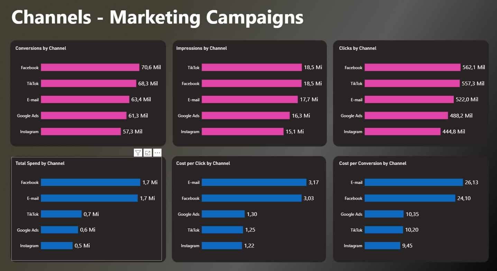
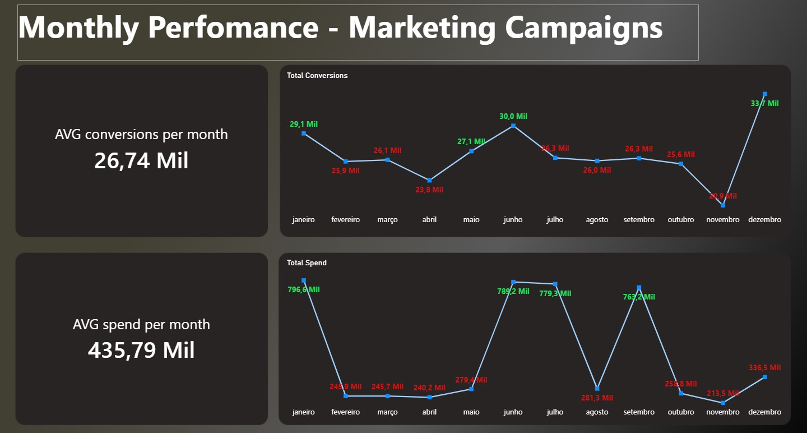

# Marketing Campaign Analysis

Projeto de análise de dados desenvolvido em **Power BI** com o objetivo de avaliar o desempenho de campanhas de marketing, comparando diferentes canais e identificando tendências mensais.

O trabalho envolve preparação e tratamento de dados, criação de indicadores (KPIs), desenvolvimento de dashboards e análise dos resultados.

## Dashboard

### Desempenho por canal

Comparação entre canais considerando conversões, impressões, cliques, investimentos e custos por resultado.

### Desempenho mensal

Análise da evolução mensal das conversões e dos investimentos, identificando períodos de maior e menor desempenho.

## Principais resultados

- **Facebook:** maior volume de conversões, com aproximadamente 71 mil.
- **TikTok:** resultados próximos aos do Facebook, com cerca de 1 milhão a menos em investimento.
- **Instagram:** menores custos médios, com CPC de 1,22 e CPA de 9,45.
- **Sazonalidade:** janeiro, junho e dezembro apresentaram os maiores volumes de conversões.

## Ferramentas utilizadas

- Power BI
- Power Query
- DAX

## Fonte dos dados

[Marketing Campaign Data (Messy) – Kaggle](https://www.kaggle.com/datasets/govindsingh9447/marketing-campaign-data-messy)

## Limitações

O conjunto de dados não possui informações de receita ou lucro. Portanto, não foi possível calcular o ROI ou determinar o retorno financeiro efetivo das campanhas.
